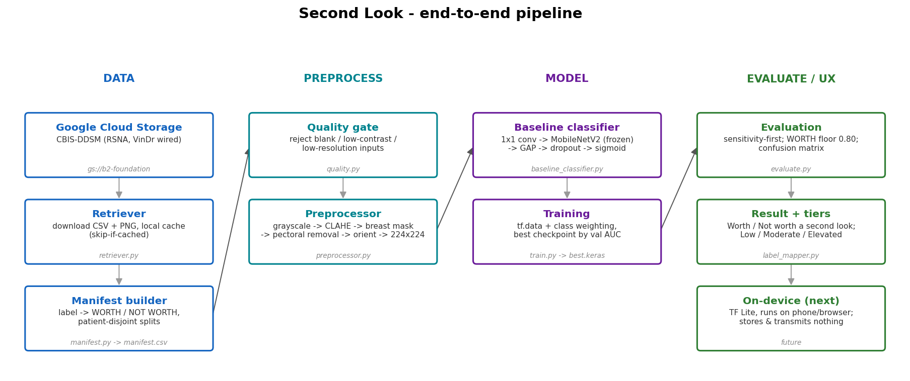
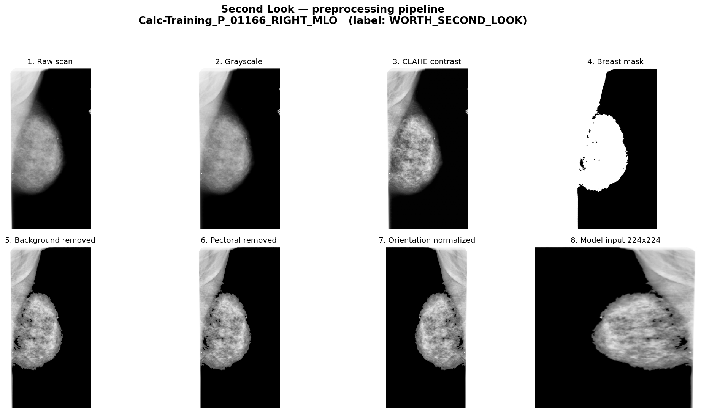

<div align="center">

# Second Look

**A privacy-first mammogram triage model that tells you whether an image is worth a second look, and that runs entirely on the device.**


[Overview](#overview) · [How it works](#how-it-works) · [Mobile apps](#6-mobile-apps) · [Results](#results) · [What we learned](#what-we-learned) · [Limitations](#known-limitations) · [Roadmap](#roadmap) · [Getting started](#getting-started)

</div>

> [!IMPORTANT]
> Second Look is a **research prototype**. It is not a medical device, it has not been clinically validated, and it must not be used to make or replace any medical decision.

---

## Overview

Breast cancer screening relies on radiologists reading large numbers of mammograms, most of which are normal. Second Look explores a narrow, safety-first question: **can a small model look at a single mammogram and flag the ones that deserve a closer look, without the image ever leaving the device?**

The design has three commitments:

- **Binary, not diagnostic.** The model outputs one probability: `WORTH_SECOND_LOOK` vs `NOT_WORTH_SECOND_LOOK`. It does not diagnose cancer. A separate UX layer turns the calibrated probability into a coarse concern tier: **Low / Moderate / Elevated**.
- **On-device and private.** The model ships as TensorFlow Lite inside [iOS and Android apps](#mobile-apps) that run it locally and store and transmit nothing. Every architecture choice (MobileNetV2, 224×224 input, no custom ops) is made to keep that path open.
- **Missing a case is the worst failure.** The project optimizes for sensitivity on the positive class, with a hard floor of **80% sensitivity**. False alarms are preferred over false reassurance.

## How it works

<p align="center">
  
</p>

### 1. Data

Three public datasets are pulled from Google Cloud Storage, mapped to one binary label, and merged into a single manifest with **patient-disjoint** train / validation / test splits.

| Dataset | Images | Positive rate | What counts as `WORTH_SECOND_LOOK` |
|---|---:|---:|---|
| [CBIS-DDSM](https://www.cancerimagingarchive.net/collection/cbis-ddsm/) | ~2.9k | ~87% | Biopsied lesions (malignant or benign) |
| [RSNA Screening Mammography](https://www.kaggle.com/competitions/rsna-breast-cancer-detection) | 54,706 | ~2% | Confirmed cancer |
| [VinDr-Mammo](https://physionet.org/content/vindr-mammo/1.0.0/) | 20,000 | ~5% | BI-RADS 4–5 |
| **Combined** | **~77.5k** | **~6%** | |

The combined set is deliberately **mostly negative**, which matches what a real screening population looks like. INbreast is also wired in for smoke testing.

### 2. Preprocessing

Every image passes a **quality gate** (rejects blank, low-contrast, or low-resolution inputs), then a deterministic preprocessing chain:

<p align="center">
  
</p>

Grayscale → CLAHE contrast enhancement → breast mask → background removal → pectoral muscle removal → orientation normalization → 224×224 model input.

The pipeline also ships nine "real-world capture" augmentations (glare, motion blur, compression, moiré, brightness, contrast, occlusion, perspective, rotation) that mimic a phone photo of a screen or film. They are built and tested but not yet used in training runs.

### 3. Model

```
grayscale 224×224
  → 1×1 Conv (1 → 3 channels; keeps the model TF Lite safe, no Lambda layers)
  → MobileNetV2 backbone (ImageNet weights)
  → Global average pooling → Dropout
  → Dense(1, sigmoid) → P(WORTH_SECOND_LOOK)
```

The model is trained with a **two-phase fine-tune**:

1. Train only the classification head, with the backbone frozen.
2. Unfreeze the convolutional layers at a low learning rate (1e-5), **keeping BatchNorm frozen**.

Unfreezing everything at once made the model collapse to "flag everything" on small, imbalanced batches. The two-phase recipe fixed that and became the champion.

### 4. Evaluation

Accuracy is misleading on this data: a model that flags every CBIS image scores about 91% accuracy and is useless. Every run is scored with a fixed protocol:

| Metric | Why it is reported |
|---|---|
| **AUROC** | Threshold-independent ranking quality; the headline number. |
| **Macro-F1** | Exposes a model that collapses to one class, which AUROC and the sensitivity floor both miss. |
| **Operating point** | The threshold that maximizes specificity while keeping sensitivity ≥ 80%. Reports specificity, precision, and the number of false alarms. |
| **Calibration** | Brier score, ECE, and a reliability diagram. Temperature scaling is fitted on validation data. |

### 5. Training infrastructure

Training runs as Google **Vertex AI** custom jobs on an NVIDIA T4, in the same region as the data bucket. One job downloads the ~178 GB dataset **once**, then trains and evaluates a whole sweep of configurations against the same splits. Each config writes its own checkpoint, calibration file, and a row in a ranked summary. Preprocessed images are cached in memory after the first epoch. Together with the GPU, that turned a projected ~3-day CPU run into ~10 hours.

### 6. Mobile apps

The [`frontend/`](frontend/) folder holds native apps that run the whole flow on the phone: a disclaimer gate, then capture or select an image, then a result with a probability and a Low / Moderate / Elevated tier. Nothing is uploaded.

| App | Stack | Preprocessing |
|---|---|---|
| [iOS](frontend/README.md) | SwiftUI, TensorFlow Lite (CocoaPods) | OpenCV port of the Python pipeline (Objective-C++) |
| [Android](frontend/android/README.md) | Jetpack Compose, TensorFlow Lite | The research pipeline's own Python code, run on-device through Chaquopy |

Both apps bundle a ~4.4 MB `second_look.tflite` that takes a 224×224×1 input. The tier cut-points in the apps are still provisional.

## Results

All numbers below are on the **full combined test set: 12,558 images, 738 positives (5.9%)**, which is a realistic screening distribution.

### Headline

| Model | AUROC | Specificity at 80% sensitivity | Precision at 80% sensitivity |
|---|---:|---:|---:|
| Frozen MobileNetV2 (head only) | 0.792 | 0.51 | — |
| **Two-phase fine-tuned MobileNetV2** | **0.82** (0.807–0.837 over 6 runs) | **~0.57** | **~0.10** |

**What this means in plain terms:** to catch 80% of the positive cases, the current model also flags about 43% of the normal images. Because positives are rare, roughly **9 out of 10 flags are false alarms**. This is a solid, honest baseline and **not a deployable model**.

### Experiments

Each experiment ran inside a single Vertex job, with the control in the same job, so the comparisons are paired.

| Experiment | Result | Decision |
|---|---|---|
| Two-phase fine-tune vs frozen backbone | AUROC 0.810 vs 0.792 and specificity 0.56 vs 0.51 at full scale (tied on small subsets) | ✅ Adopted |
| Naive full unfreeze | Collapsed toward "flag everything" (macro-F1 0.37–0.68) | ❌ Rejected |
| Focal loss / no class weights | Small, inconclusive change in specificity | ➖ No large gain |
| Rebalance the dataset mix (cap negatives per dataset) | Specificity fell to 0.52, below every control run | ❌ Harmful |
| Input resolution 224 → 288 → 320 | Specificity +0.036, under 2× the noise | ➖ Not worth the on-device cost |
| Temperature scaling | ECE ~50× lower on focal-loss models (0.112 → 0.002); little change on the class-weighted champion (0.218 → 0.212) | ✅ Adopted, more work needed |
| Six repeat runs of the same recipe | AUROC spread 0.807–0.837; specificity sd ≈ 0.02 | Sets the noise floor |

### Milestones

| Date (2026) | Milestone |
|---|---|
| Jun | End-to-end pipeline (build → preprocess → train → evaluate) validated on real CBIS data |
| Jul | First Vertex AI baseline: CBIS-only, AUROC 0.830 (only 37 test negatives, so wide error bars) |
| Aug | CBIS + RSNA + VinDr combined; sweep harness; two-phase fine-tune; first full-scale GPU run |
| Aug | Class-imbalance levers (focal loss, mix rebalancing) and temperature-scaling calibration |
| Sep | Noise-floor and input-resolution studies |
| Oct | Data and preprocessing audit; multi-view redesign prototyped |

## What we learned

1. **Accuracy lies on imbalanced data.** Headline AUROC, macro-F1, and sensitivity at the floor instead.
2. **Small subsets are optimistic.** Equal-per-dataset subsets reached ~0.94 AUROC. The full, mostly negative distribution gives ~0.82. Precision and specificity depend on prevalence, so only a full run can measure them.
3. **One run is one sample.** The same recipe on the same splits scored 0.810 and 0.837 AUROC. Every comparison now runs its control in the same job.
4. **Reweighting cannot fix separability.** Focal loss and rebalancing move the decision threshold. The real limit is that the classes are hard to separate from a single 224×224 image, so the next gains must add *signal*, not re-price errors.
5. **Calibration is cheap, but not automatic.** A single fitted temperature made focal-loss models well calibrated, but barely helped the class-weighted champion. The Low / Moderate / Elevated tiers need calibrated probabilities, so this stays open.

## Known limitations

An October 2026 audit of the data pipeline found issues that cap the current model. The planned redesign targets them:

- **Label meaning differs across datasets.** CBIS counts biopsied *benign* lesions as positive, while RSNA labels them negative and VinDr uses BI-RADS 4–5.
- **CBIS split leakage.** A small number of CBIS patients and images appear in both the official train and test sets.
- **Heavy downsampling.** Full-resolution mammograms are squashed to 224×224, a 13–23× reduction that also distorts the aspect ratio. Fine calcifications can be lost.
- **Quality-gate side effect.** Images that fail the quality gate become blank inputs but keep their label (about 6% of RSNA and 12% of VinDr).
- **Optimistic operating point.** The 80%-sensitivity threshold is currently chosen on the test set and scored per image, not per breast. AUROC is not affected.
- **No export step in the training code.** The apps' `.tflite` is produced outside this pipeline, so there is no script yet that turns a training checkpoint into the bundled model.

## Roadmap

- [x] Data pipeline for CBIS-DDSM, RSNA, and VinDr-Mammo
- [x] Locked evaluation protocol (AUROC, macro-F1, operating point, calibration)
- [x] Full-scale training on Vertex AI with a sweep harness
- [x] Calibration with temperature scaling
- [x] iOS and Android apps running a TF Lite model on-device
- [ ] Consistent label definitions across datasets, and a leakage-free CBIS split
- [ ] Use the region annotations the datasets already provide (VinDr boxes, CBIS masks)
- [ ] Combine the four views of an exam (L/R × CC/MLO) per breast before deciding
- [ ] Higher input resolution, if it stays within the on-device budget
- [ ] Choose the threshold on validation data; set the concern tiers from calibrated probabilities
- [ ] Reproducible TF Lite export from the training pipeline, with on-device size and latency measurements
- [ ] Dataset cards and license documentation

## Getting started

```bash
git clone git@github.com:benevolentbandwidth/secondlook.git
cd secondlook
python -m venv .venv && source .venv/bin/activate   # Windows: .venv\Scripts\activate
pip install -r requirements.txt
pytest tests/ -v                                     # data-dependent tests skip cleanly
```

Building the datasets needs read access to the project's GCS bucket. See **[INSTRUCTIONS.md](INSTRUCTIONS.md)** for authentication, dataset builds, Vertex AI training, sweeps, and the evaluation protocol.

## Repository structure

```
secondlook/
├── config/           # constants (input size, seed, split ratios), label maps, GCS sources
├── data_pipeline/    # retriever, manifest builder, splitter, label mapper,
│                     # preprocessor, quality gate, augmentations
├── modeling/         # MobileNetV2 classifier, training (incl. two-phase), losses,
│                     # dataset-mix rebalancing, calibration, evaluation
├── scripts/          # build_dataset.py, train_vertex.py, sweep_vertex.py
├── vertex/           # Vertex AI job configs (full run, subset, seeds, resolution)
├── demos/            # pipeline diagram, preprocessing and augmentation grids, notebooks
├── frontend/         # on-device apps: iOS (Xcode project at this level) and android/
└── tests/            # unit, mocked-GCS, and data-gated smoke tests
```

## Acknowledgements

This work uses the following public datasets. Each has its own license and terms of use:

- **CBIS-DDSM:** Lee, R. S. et al., *A curated mammography data set for use in computer-aided detection and diagnosis research*, Scientific Data (2017). Hosted by The Cancer Imaging Archive.
- **RSNA Screening Mammography Breast Cancer Detection:** Radiological Society of North America, Kaggle (2022).
- **VinDr-Mammo:** Nguyen, H. T. et al., *VinDr-Mammo: A large-scale benchmark dataset for computer-aided diagnosis in full-field digital mammography*, Scientific Data (2023). Hosted on PhysioNet.
- **INbreast:** Moreira, I. C. et al., Academic Radiology (2012).
